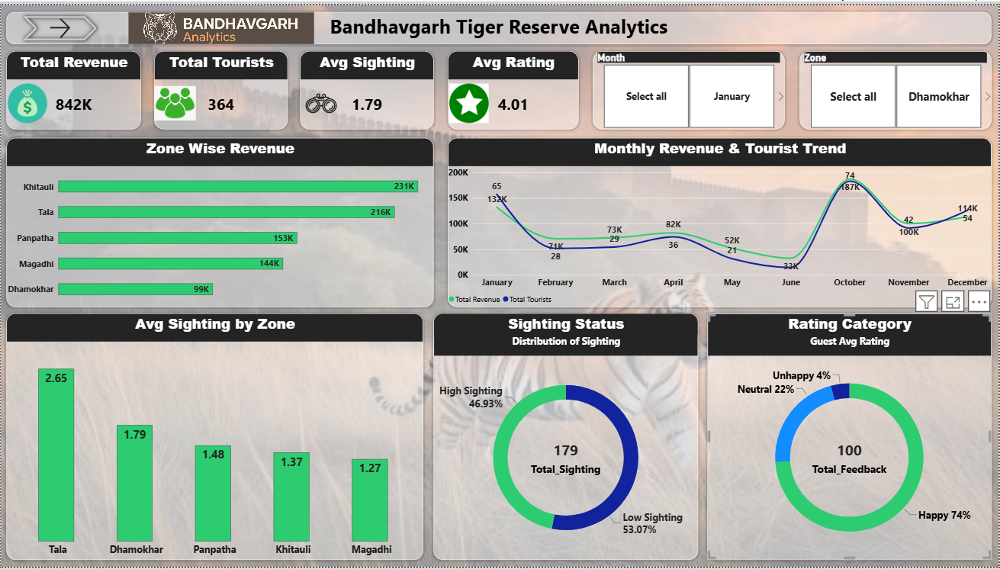
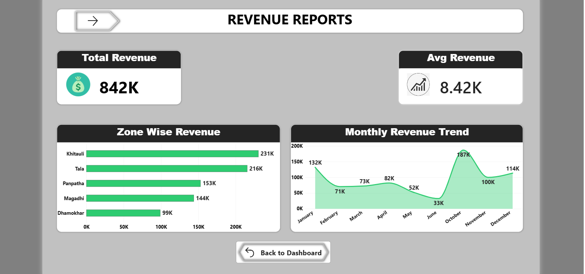
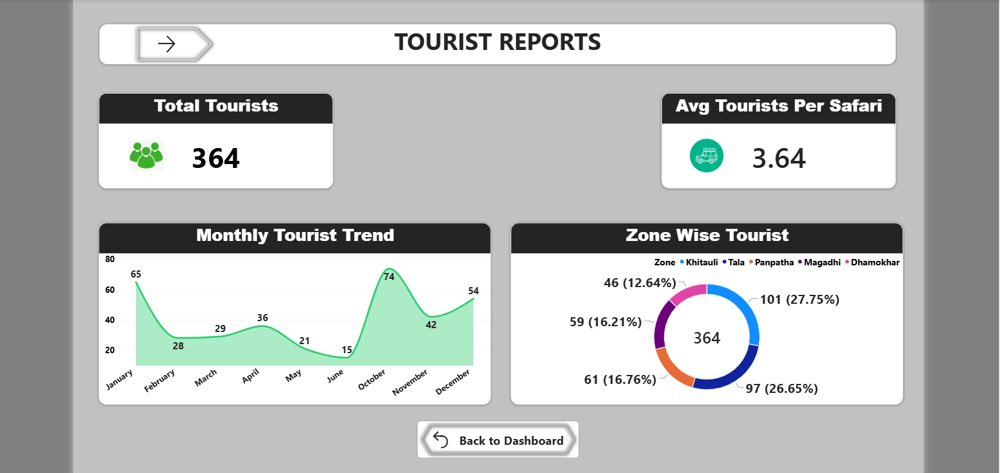
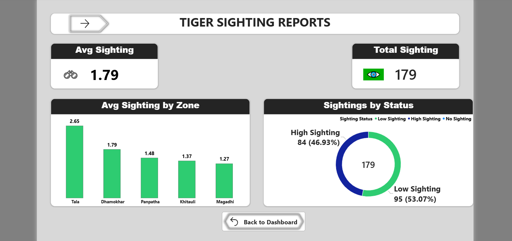
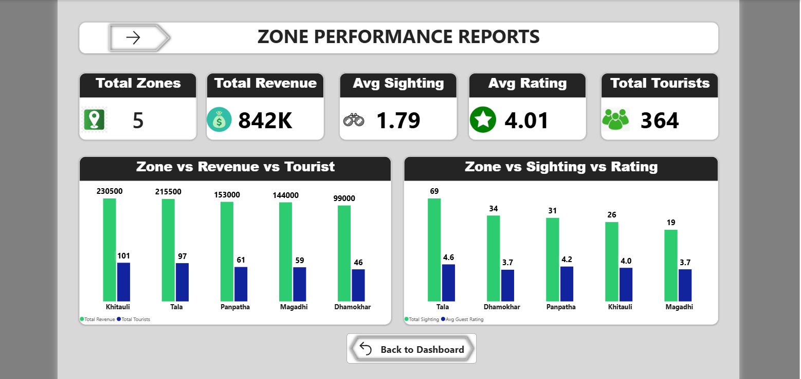
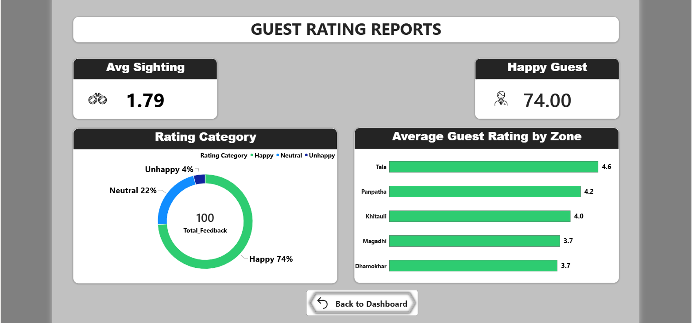

# Bandhavgarh Tiger Reserve Data Analysis (Interactive Dashboard Creation using Power BI)

## Project Objective
Bandhavgarh Tiger Reserve management wants to analyze their safari operations from October 2023 to June 2024. So that, the management can understand zone-wise revenue, tourist footfall, tiger sighting probability, and guest satisfaction to improve overall safari planning and visitor experience.

## Dataset used
* [Dataset](https://github.com/subhodeep729-sudo/Bandhavgarh-Tiger-Reserve-PowerBI-Analysis/blob/main/safari_bookings.xlsx)

## Questions (KPIs)
* What is the total revenue, total tourist footfall, average tiger sighting per safari, and average guest rating?
* Which zone generates the highest revenue and attracts the highest number of tourists?
* What is the monthly trend of revenue and tourist bookings from October 2023 to June 2024?
* Which zone has the highest tiger sighting rate, and what is the distribution of sighting status (High vs. Low/No Sighting)?
* How does tiger sighting frequency impact overall guest ratings and the percentage of happy guests across different zones?

## Dashboard Interface
* [Interactive Power BI File (.pbix)](https://github.com/subhodeep729-sudo/Bandhavgarh-Tiger-Reserve-PowerBI-Analysis/blob/main/Bandhavgarh%20jungle%20safari%20analytics.pbix)

## Process
Firstly, checked for any missing values or duplicate records across all three sheets (`safari_bookings`, `tiger_sighting`, and `visitor_feedback`) and removed the blank `Sheet1`. Made sure all data types (Date, Zone, Revenue, Tourists, Sighting Count, and Rating) were consistent. Built a Star Schema data model in Power BI by creating custom `Dim_Date` and `Dim_Zone` dimension tables with `1-to-Many` relationships, wrote DAX measures for KPIs, and designed a 6-page interactive dashboard with slicers and page navigation buttons.

## Dashboard Images

### 1. Executive Overview Dashboard

### 2. Revenue Reports

### 3. Tourist Reports

### 4. Tiger Sighting Reports

### 5. Zone Performance Reports

### 6. Guest Rating Reports

## Project Insight
Bandhavgarh Tiger Reserve generated a total revenue of **₹8,42,000** from **364 tourists** across **100 safaris** (an average of ₹8,420 per booking and 3.64 tourists per safari). **Khitauli** emerged as the top revenue-generating zone (**₹2,30,500**) with the highest tourist footfall (**101 tourists**), closely followed by **Tala** (**₹2,15,500** and **97 tourists**). Peak bookings and revenue occurred in **October** (**₹1,87,000**) and **January** (**₹1,32,000**). Across all safaris, **179 tiger sightings** were recorded (average **1.79 sightings/safari**), with **Tala** recording the highest sighting rate (**2.65 sightings/safari**) and the highest guest rating (**4.56 / 5.0**), contributing to an overall rating of **4.01 / 5.0** and **74% Happy Guests**.

## Final Conclusion
To maximize revenue and visitor satisfaction, park management should promote **Tala** as a premier wildlife sighting zone while maintaining strong booking capacity in **Khitauli**. Additionally, management should focus on improving guide quality, jeep punctuality, and safari scheduling in lower-rated zones like **Dhamokhar (3.67 / 5.0)** and **Magadhi (3.72 / 5.0)**, and introduce targeted promotional packages during off-peak summer months (May–June) to boost tourist footfall.
